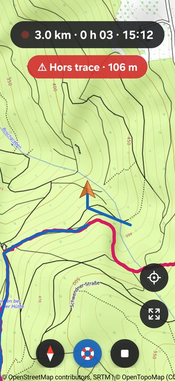
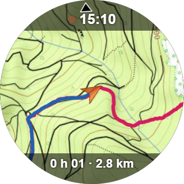
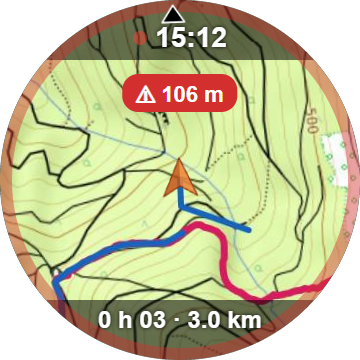

# BLRando

A hiking map for Android phones, mirrored on a Samsung Galaxy Watch (2018, Tizen) through the watch's web browser.
It uses the OpenTopoMap topographic map, which looks the same in France, Germany or anywhere else.

- Follow a reference GPX track. A "lifebuoy" vibrates when you stray more than 50 m from it.
- Record your hike as a GPX file.
- See the map, your position and the alerts on the watch, with the phone in your pocket and its screen off.

## Screenshots

**Phone:** recording, the whole track ("fit"), and off track with the lifebuoy on.

<p>



</p>

**Watch:** following the hiker, the menu, the stop confirmation, the whole track, and off track.

<p>




</p>

The blue line is the recorded trail, the pink line the reference track.

## Install

There is no ready-made APK: build it from the sources (Android 11 or later).

1. Install [Android Studio](https://developer.android.com/studio) (or just the Android SDK and a JDK).
2. Plug in the phone with USB debugging on, then from this folder:

   ```
   gradlew assembleDebug
   adb install -r app\build\outputs\apk\debug\app-debug.apk
   ```

3. On first launch, allow location "all the time" (needed to record with the screen off) and notifications.

### Watch (optional)

The watch needs Samsung's **Internet** browser for Galaxy Watch. If it is missing on your watch, see
[Technical notes](#technical-notes).

1. On the phone, turn on the **mobile hotspot**, set to **2.4 GHz** (the watch doesn't see 5 GHz).
   Connect the watch to it. It works without mobile network.
2. In BLRando, tap the time banner: it shows the address to type on the watch, such as `10.x.x.x:8765`.
3. On the watch, open Internet and type that address. Bookmark the page that appears, then tap **Ouvrir la carte**.
   Next time, open the bookmark: the watch browser doesn't reopen the last page by itself.

## Use

### Phone

- **Folder** (bottom): open a reference GPX track, or send one to BLRando with "Share" from another app.
  A long press removes it.
- **Lifebuoy** (blue when on): three long vibrations when you are more than 50 m from the track,
  repeated every minute, and one short vibration when you are back.
- **Red dot**: start recording, confirmed with a button. While recording it becomes a **stop** button.
  The file goes to `Downloads/BLRando/YYYYMMDD_HHMM.gpx`, saved every 30 s.
- **Compass** (bottom left): north up, or walking direction up (blue).
- **Right side**: back to your position, and show the whole track.
- The top banner shows distance · duration · time while recording. The duration includes breaks.
- A long press on the map opens a Google Maps itinerary to that point.

### Watch

- **Bezel**: zoom. Three clicks = one zoom level.
- **Drag** the map with a finger to look around. The map turns north up and your position stays drawn as an arrow.
- **Tap** the map for the menu:
  - left arrow: close the menu;
  - red dot / red square: start or stop recording, tap a second time to confirm.
    Starting from the watch also turns the lifebuoy on when a track is loaded;
  - target: back to your position;
  - four arrows: the whole track.
- The phone and the watch show the same place. Zoom, drag, "whole track" and "back to position" on one
  device apply to the other one too.
- Off track: red ring and the distance, with vibrations. "Plus de liaison avec le téléphone" means the watch
  no longer reaches the phone. Check that it is still on the phone's hotspot.

For your privacy, the phone serves the watch page **only through its own hotspot**, never on a shared Wi-Fi
(home, office, hotel), where anyone could otherwise see your position.

## Technical notes

### Why a web page on the watch

Samsung no longer issues the developer certificates a Tizen watch trusts, so a real Tizen app can't be installed
on a Galaxy Watch 2018 any more. Instead, BLRando contains a small web server (`WatchServer`, port 8765).
The watch's Internet browser displays a page (`watch/`, bundled as `assets/watch/`) that polls the phone:

- `/frame`: a 360×360 map image drawn by the phone (`WatchRenderer`, `WatchFeed`), every 5 s while the watch
  screen is on (15 s when the phone battery is low), and at once after a change;
- `/beat`: a small status every 10 s (recording, distance, off track, GPS lost, phone battery...);
- `/msg?b=<base64 JSON>`: watch to phone messages (zoom, pan, menu commands), handled by `WatchLink`.

The page reloads itself when BLRando is updated (`ver` field). It only answers requests coming through the
hotspot interface (or loopback, for `adb forward` tests).

### Zoom between the two screens

The phone zoom is the watch zoom plus a fixed offset computed from the two screen widths (`zoomOffset`, about +1.1
on a Galaxy S25). "Whole track" gives the same result whichever device asks, and fills both screens.
"Back to position" uses the walking zoom (`CENTER_ZOOM`, 15 on the watch).

### Watch browser quirks (handled in `watch/main.js`)

- The bezel sends real `rotarydetent` events, and also scrolls the page by 120 px per click. Scrolling is only
  used until a real event arrives.
- No compass events: the map turns with the GPS walking direction sent by the phone.
- The page is frozen while the watch screen is off. The watch's Wi-Fi sleeps while Bluetooth is connected.
- `?debug` in the address shows which events arrive.
- If the Internet browser is missing, it can be installed over `sdb` (Tizen Studio) from a package with the
  original Samsung signature: `pkgcmd -i -t tpk -p <file> -w`.

### Testing at the desk (debug builds only)

The debug build accepts fake GPS fixes and watch messages over adb (`app/src/debug/`, absent from release builds):

```
adb shell am broadcast -a fr.amandio.blrando.DEBUG_FIX -p fr.amandio.blrando --ef lat 48.5834 --ef lon 7.7458
adb shell am broadcast -a fr.amandio.blrando.DEBUG_MSG -p fr.amandio.blrando --es b64 eyJ0IjoiaGVsbG8ifQ==
```

- `watch-preview/preview.html`: the watch page on a PC, 360×360 round screen. The mouse wheel is the bezel and
  Esc the back key. `#menu` and `#armed` open the menu or the confirmation screen.
- `watch-preview/bridge.py`: serves the preview with the phone's real frames over adb, and can walk the phone
  along its reference track.

### Icon

"BL" family icon (gradient, four outward arrows, center), see [iconkit/README.md](iconkit/README.md).
