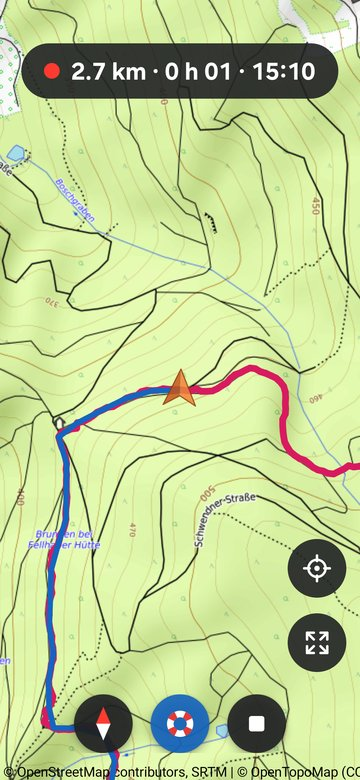
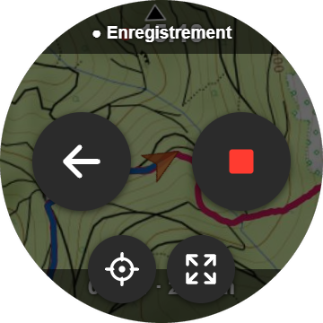
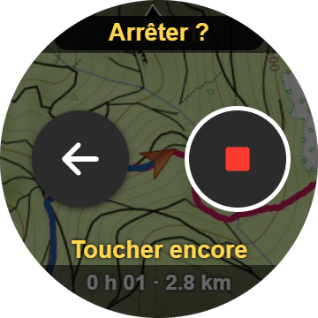

# BLRando

Une carte de randonnée pour téléphone Android, qui s'affiche aussi sur une montre Samsung Galaxy Watch.

- Tu charges le tracé de ta rando : il s'affiche en rose sur la carte. Une **voiture** marque le départ, un
  **drapeau à damier** l'arrivée (sauf si c'est une boucle).
- La **bouée** te prévient en vibrant si tu t'éloignes de plus de 50 m du tracé.
- Tu peux **enregistrer** ta sortie : le chemin parcouru s'affiche en bleu.
- Sur la montre, tu vois la carte, ta position, le nord, le soleil avec l'heure du coucher et la lune, sans sortir
  le téléphone de ta poche.

La carte est la carte topographique OpenTopoMap, la même en France, en Allemagne et ailleurs.

## Captures d'écran

**Sur le téléphone** : en enregistrement, le tracé entier, et une alerte « hors trace ».

**Sur la montre** : le nord, le soleil, l'heure du coucher et la lune sur le bord, la voiture au départ ; puis le
suivi, le menu, la confirmation d'arrêt, le tracé entier et l'alerte « hors trace ».

## Installer l'appli sur le téléphone

Il faut un téléphone Android 11 ou plus récent. BLRando n'est pas sur le Play Store : on le télécharge ici.

1. Sur le téléphone, ouvre ce lien : **[télécharger BLRando](https://github.com/amandiofr/BLRando/releases/latest/download/BLRando.apk)**.
2. Ouvre le fichier téléchargé (`BLRando.apk`).
3. Android te demande d'autoriser ton navigateur à installer des applis : accepte, puis appuie sur **Installer**.
   Si Play Protect affiche un avertissement, choisis **Installer quand même**.
4. Au premier lancement, réponds **Toujours autoriser** pour la position (sinon le suivi s'arrête quand l'écran
   s'éteint) et **Autoriser** pour les notifications.

**Mises à jour** : quand une nouvelle version sort, BLRando te la propose la première fois que tu l'ouvres dans
la journée. Appuie sur **Mettre à jour**. La première fois, Android te demande d'autoriser BLRando à installer des
applis : accepte.

## Utiliser l'appli sur le téléphone

**Charger un tracé** : appuie sur le **dossier** en bas et choisis un fichier GPX (celui que tu as téléchargé sur
un site de randonnée, par exemple). Depuis une autre appli, tu peux aussi faire « Partager » vers BLRando.
Un appui long sur le dossier retire le tracé.

Les boutons :

- **Bouée** : allume l'alerte. Si tu t'éloignes de plus de 50 m du tracé, le téléphone vibre trois fois, et
  recommence chaque minute. Quand tu reviens sur le tracé, une petite vibration te le dit.
- **Point rouge** : démarre l'enregistrement de ta sortie (il faut confirmer). Le bouton devient un carré pour
  arrêter. Ta sortie est rangée dans le dossier **Téléchargements/BLRando** du téléphone.
- **Boussole** (en bas à gauche) : la carte reste le nord en haut, ou tourne dans le sens de la marche (bleu).
- **Cible** (à droite) : revenir sur ta position.
- **Quatre flèches** (à droite) : voir tout le tracé.
- En haut : l'heure, et pendant un enregistrement la distance et la durée.
- Un appui long sur la carte ouvre un itinéraire Google Maps jusqu'à ce point.

## La montre (facultatif)

Il faut une montre Samsung Galaxy Watch avec le navigateur **Internet** de Samsung (par exemple la Galaxy Watch de
2018). La montre n'a rien à installer : elle affiche une page que le téléphone lui envoie.

**La première fois :**

1. Sur le téléphone, active le **point d'accès mobile** : Paramètres > Connexions > Point d'accès mobile et modem.
   Dans les réglages du point d'accès, choisis la bande **2,4 GHz** (la montre ne voit pas le 5 GHz).
2. Sur la montre, connecte-toi à ce point d'accès : Paramètres > Connexions > Wi-Fi.
   Pas besoin de réseau mobile ni d'Internet : ça marche aussi en pleine montagne.
3. Dans BLRando, touche le **bandeau de l'heure** en haut : il affiche une adresse comme `10.1.2.3:8765`.
4. Sur la montre, ouvre **Internet** et tape cette adresse. Ajoute la page aux favoris, puis touche
   **Ouvrir la carte**.

**Les fois suivantes** : point d'accès allumé, BLRando ouvert, puis sur la montre ouvre Internet et le favori.

Sur la montre :

- **Tourner la lunette** : zoomer ou dézoomer.
- **Glisser le doigt** : déplacer la carte. Le nord revient en haut et ta position reste dessinée par la flèche.
- **Toucher la carte** : le menu.
  - flèche : fermer le menu ;
  - point rouge ou carré rouge : démarrer ou arrêter l'enregistrement (toucher une deuxième fois pour confirmer) ;
  - cible : revenir sur ta position ;
  - quatre flèches : voir tout le tracé.
- **Sur le bord** : le N montre le nord, le soleil et la lune sont dans leur vraie direction (pâles quand ils sont
  sous l'horizon), et l'heure du coucher du soleil est écrite à côté du soleil. La lune montre sa phase.
- Le téléphone et la montre montrent toujours le même endroit : ce que tu fais sur l'un se fait sur l'autre.
- **Hors trace** : anneau rouge, distance et vibrations.
- **« Plus de liaison avec le téléphone »** : la montre ne joint plus le téléphone. Vérifie que le point d'accès
  est allumé et que BLRando est ouvert.

**Vie privée** : le téléphone n'envoie la carte que par son propre point d'accès, jamais sur un Wi-Fi partagé
(maison, bureau, hôtel), où quelqu'un d'autre pourrait voir ta position.

## Pour les développeurs

Compilation, publication et fonctionnement interne : [docs/TECHNICAL.md](docs/TECHNICAL.md).
