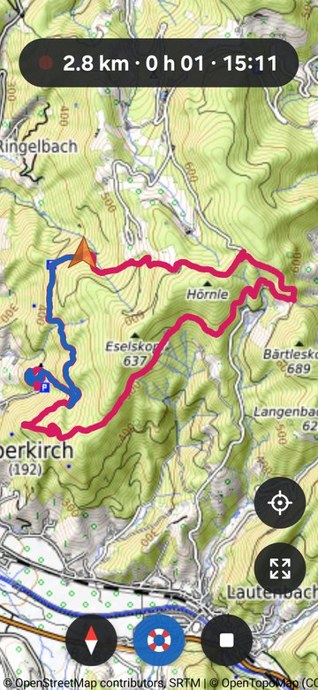
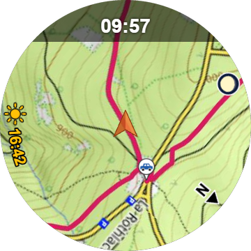
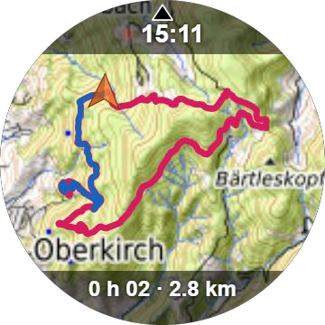

# BLRando

A hiking map for Android phones, also shown on a Samsung Galaxy Watch.

- Load the track of your hike: it shows on the map, with a **car** at the start.
- **Google Maps** takes you to the start: a long press on the map opens the directions.
- The **lifebuoy** vibrates when you stray from the track.
- You can **record** your hike.
- On the **watch**, you see the map and where you are, with the phone in your pocket.

The map is OpenTopoMap, a hiking map that covers France, Germany and the rest of the world.

## Screenshots

**Phone**: recording, the whole track, off the track.

**Watch**: north, sun, sunset time and moon on the edge; following, menu, stop, whole track, off the track.

## Install

You need an Android 11 phone or newer. BLRando is not on the Play Store.

1. On the phone, open this link: **[download BLRando](https://github.com/amandiofr/BLRando/releases/latest/download/BLRando.apk)**.
2. Open the downloaded file and tap **Install**. If Android or Play Protect asks, allow it.
3. When BLRando asks for your location, choose **Allow all the time**.

**Updates**: when a new version is out, BLRando offers it when you open it. Tap « Mettre à jour ».

## Use

- **Folder** (bottom): load a track (GPX file).
- **Lifebuoy**: turns the off-track alert on or off.
- **Red dot**: start or stop recording. Your hikes go to the phone's **Download/BLRando** folder.
- **Compass**: north up, or the map turns as you walk.
- **Target**: back to where you are. **Four arrows**: the whole track.
- **Long press on the map**: directions in Google Maps.

## The watch (optional)

You need a Samsung Galaxy Watch with Samsung's **Internet** browser (for example the 2018 Galaxy Watch).
Nothing to install on the watch.

**First time:**

1. On the phone, turn on the **mobile hotspot**, set to **2.4 GHz**. No mobile network needed.
2. Connect the watch to this hotspot (watch settings > Connections > Wi-Fi).
3. In BLRando, tap the time at the top: it shows an address such as `10.1.2.3:8765`.
4. On the watch, open **Internet**, type this address, add it to the bookmarks, then tap « Ouvrir la carte ».

**Next times**: hotspot on, BLRando open, then open the bookmark on the watch.

On the watch:

- **Turn the bezel** to zoom, **drag** to move the map, **tap** for the menu.
- **On the edge**: north, the sun with the sunset time, and the moon.
- The watch and the phone always show the same place.
- « Plus de liaison avec le téléphone » means the watch lost the phone: check the hotspot and that BLRando is open.

For your privacy, the phone only talks to the watch through its own hotspot, never on a shared Wi-Fi.

## Advanced use

**Phone**

- **Long press on the folder**: remove the loaded track.
- **Share a GPX file** to BLRando from another app (mail, file manager, hiking app) to load it.
- A **checkered flag** marks the end of the track when it doesn't come back to the start.
- **Lifebuoy**: three long vibrations when you are more than 50 m from the track, repeated every minute,
  and one short vibration when you are back on it.
- **Recording**: saved every 30 s, so nothing is lost if the phone dies. When you stop, you can share the file.
  The time at the top then shows distance · duration · time; the duration includes breaks.
- **Compass button** blue: the map turns as you walk.
- **Tap the time at the top**: shows the address for the watch again.
- **Language**: the phone's language (English, French, German or Portuguese). To choose another one:
  phone settings > Apps > BLRando > Language.
- **Updates**: checked the first time you open BLRando each day, never while recording.

**Watch**

- **Bezel**: three clicks = one zoom level.
- **Dragging** the map turns it north up; your position stays shown by the arrow. The target in the menu
  brings it back.
- **Menu**: start and stop need a second tap to confirm. Starting from the watch also turns the lifebuoy on
  when a track is loaded.
- **On the edge**: the sun and the moon are dimmed when they are below the horizon. The moon shows its phase.
- **Battery**: the watch vibrates when the phone battery is at 15 % and 5 %.
- **Two watches** can share the same phone: both show the same map.

## For developers

Building, releases and how it works: [docs/TECHNICAL.md](docs/TECHNICAL.md).
